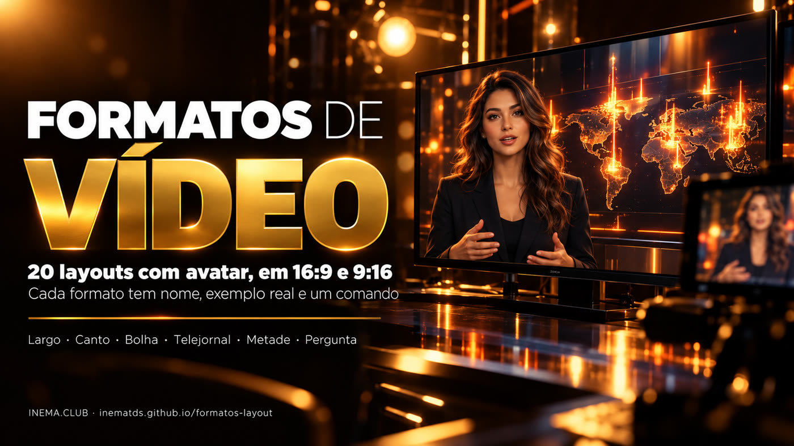

# formatos-layout

<div align="center">
  
  <p><strong>Arckhé AI</strong></p>
</div>


[](https://linnoff88-dev.github.io/

**ê°Å¸â€¡Â§ê°Å¸â€¡Â· [PortuguêƒÂªs](README.md) ê‚· ê°Å¸â€¡Âºê°Å¸â€¡Â¸ [English](README.en.md) ê‚· ê°Å¸â€¡Âªê°Å¸â€¡Â¸ [EspaêƒÂ±ol](README.es.md)**

## O que êƒÂ©

O formatos-layout êƒÂ© um catêƒÂ¡logo de formatos de vêƒÂ­deo para quem grava com um apresentador (avatar) e mostra conteêƒÂºdo junto: mapa, grêƒÂ¡fico, print ou foto. Cada formato tem um nome fixo, como Largo, Bolha ou Telejornal. Assim dêƒÂ¡ para pedir "monta no Bolha 9:16" sem explicar o layout de novo. Ele traz um script que monta o vêƒÂ­deo final a partir de dois arquivos, o vêƒÂ­deo do conteêƒÂºdo e o vêƒÂ­deo do apresentador. Para usar, basta ter o ffmpeg e o Python instalados.

## ê°Å¸â€œâ€“ Guia de uso

Guia completo, com os 20 exemplos em vêƒÂ­deo: **https://linnoff88-dev.github.io/

## Os formatos

| 16:9 (horizontal) | 9:16 (vertical) |
|---|---|
| **Largo**: conteêƒÂºdo êƒÂ  esquerda, apresentador numa coluna êƒÂ  direita | **Faixa**: conteêƒÂºdo em cima, apresentador numa faixa embaixo |
| **Canto**: conteêƒÂºdo em tela cheia, rosto num quadro no canto | **Canto**: conteêƒÂºdo em tela cheia, rosto num quadro embaixo |
| **Bolha**: conteêƒÂºdo em tela cheia, rosto num cêƒÂ­rculo | **Bolha**: conteêƒÂºdo em tela cheia, rosto num cêƒÂ­rculo |
| **Telejornal**: apresentador em tela cheia nos trechos escolhidos | **Telejornal**: apresentador em tela cheia nos trechos escolhidos |
| **Dividido**: metade conteêƒÂºdo, metade apresentador | **Apresentador**: apresentador grande, conteêƒÂºdo num cartêƒÂ£o em cima |
| **Apresentador**: apresentador domina, conteêƒÂºdo num cartêƒÂ£o | **Viral**: cortes secos a cada 2 s, fecha no apresentador |
| **DocumentêƒÂ¡rio**: sêƒÂ³ voz sobre o conteêƒÂºdo, rosto no fim | **DocumentêƒÂ¡rio**: sêƒÂ³ voz sobre o conteêƒÂºdo, rosto no fim |
| **Aula**: conteêƒÂºdo em tela cheia, rosto pequeno no canto de cima | **Metade**: avatar grande na metade de baixo |
| | **Invertido**: avatar em cima, conteêƒÂºdo embaixo |
| | **Pergunta**: Faixa no gancho ê¢â€ â€™ Canto ê¢â€ â€™ avatar grande na pergunta |
| | **Empilhado**: conteêƒÂºdo / avatar / conteêƒÂºdo em 3 faixas |
| | **Personagem**: o personagem ocupa o vêƒÂ­deo inteiro |

Detalhes, quando usar cada um e exemplos: [FORMATOS.md](FORMATOS.md).

O [FORMATOS.md](FORMATOS.md) tambêƒÂ©m traz onde o avatar aparece em cada formato e **quais formatos cada projeto de vêƒÂ­deo do ARCKHê‰ usa** (explicavideos, eventosextremospub, r7e, finviral, promoavatar, docflow e outros).

## Uso

```bash
./compor.sh --formato bolha --aspecto 16x9 --cena cena.mp4 --avatar avatar.mp4 --saida video.mp4
```

- `--cena`: vêƒÂ­deo do conteêƒÂºdo jêƒÂ¡ no aspecto final (1920êƒâ€”1080 ou 1080êƒâ€”1920).
- `--avatar`: vêƒÂ­deo 16:9 do apresentador, com a voz.
- OpêƒÂ§êƒÂµes: `--ss`/`--t` (trecho), `--trechos "0-4,30-34"` (Telejornal), `--fim 6` (DocumentêƒÂ¡rio), `--nome "..."` (plaquinha), `MUSICA=trilha.mp3`, `AV_CX`/`AV_CY` (centro do rosto).

Precisa de `ffmpeg`, Python 3 e Pillow. NêƒÂ£o usa GPU.

## LicenêƒÂ§a

MIT

---

<div align="center">
  
  <p><strong>Arckhé AI</strong></p>
</div>